

  

<h1 align="center">one more Sports 📱⚽</h1>

  <b>A seamless cross-platform sports application built with Flutter, currently live on production.</b>

  
  
  

---

## 🚀 About The Project
**one more** is a fully functional, production-grade sports application designed to deliver an exceptional user experience. Built with a strong focus on performance, clean architecture, and smooth UI/UX animations.

## 📱 App Screenshots

  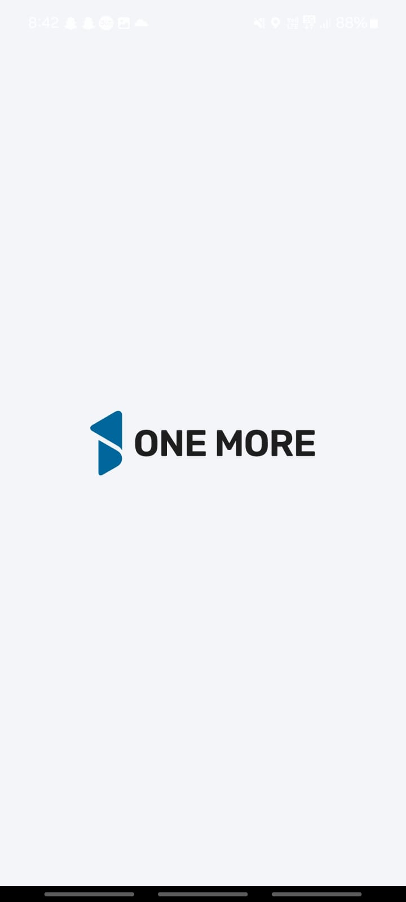
  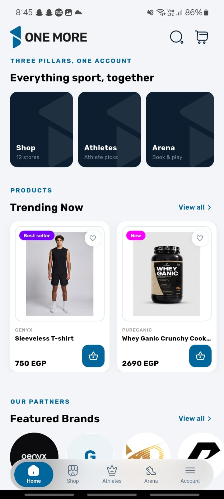
  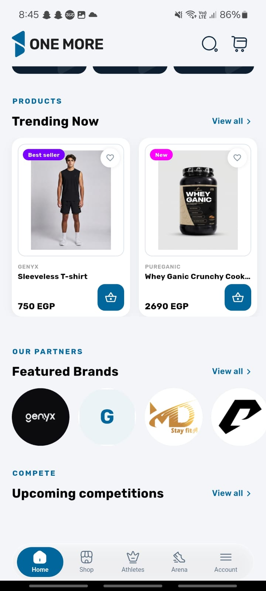
  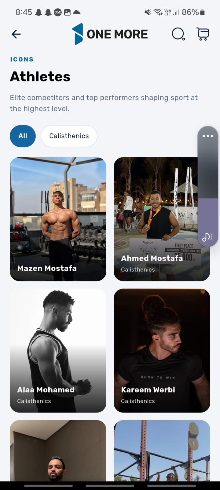
  
  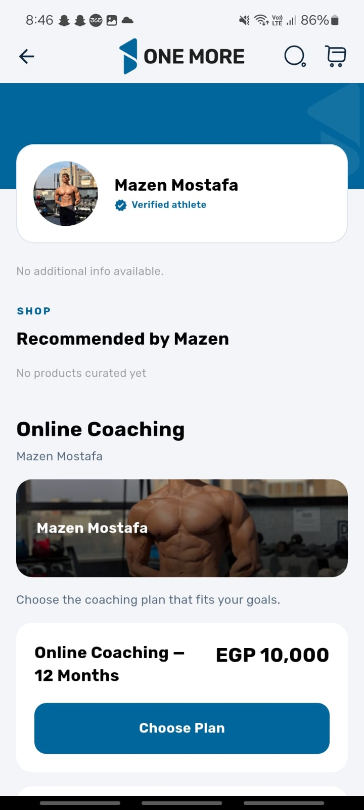
  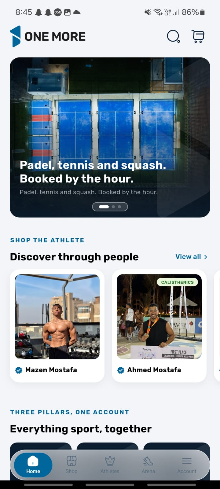
  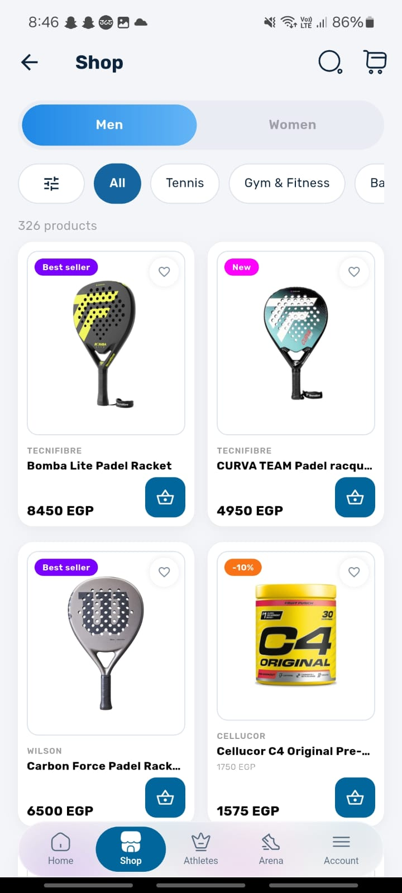
  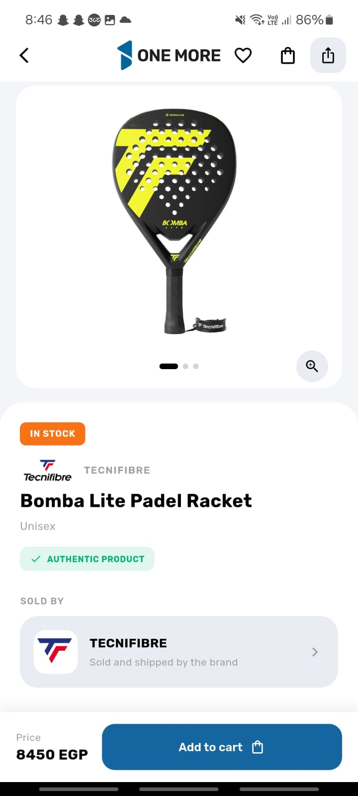
  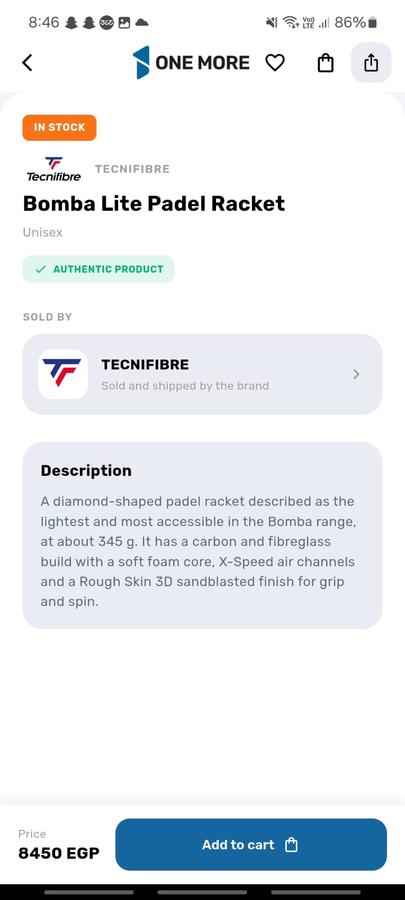
  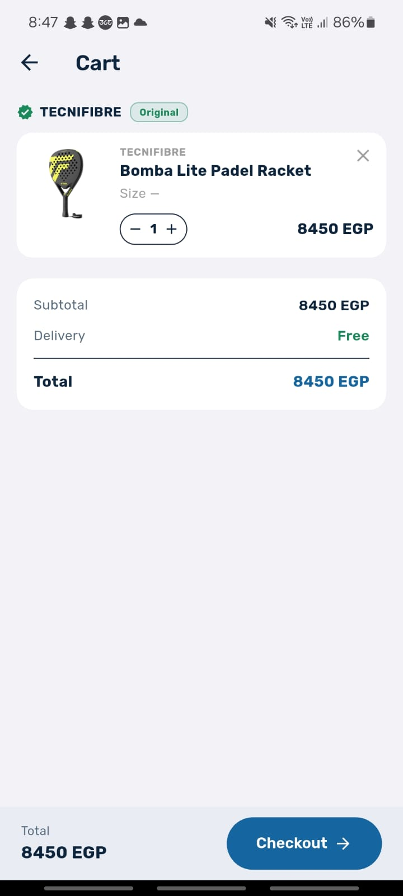
  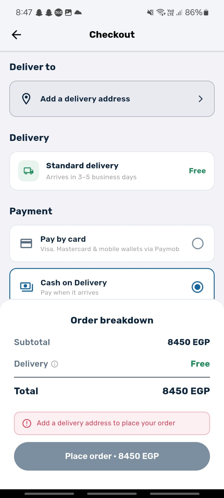
  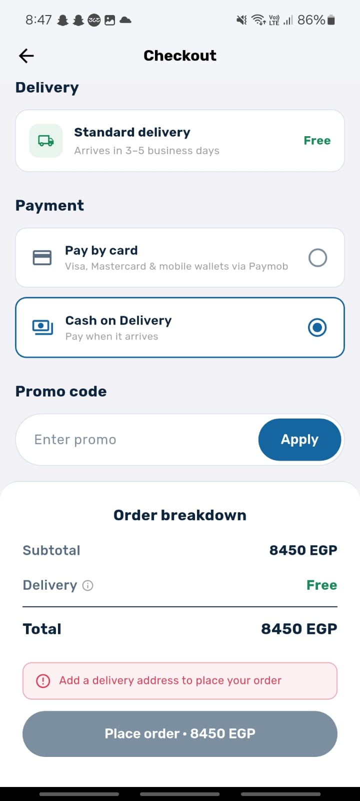
  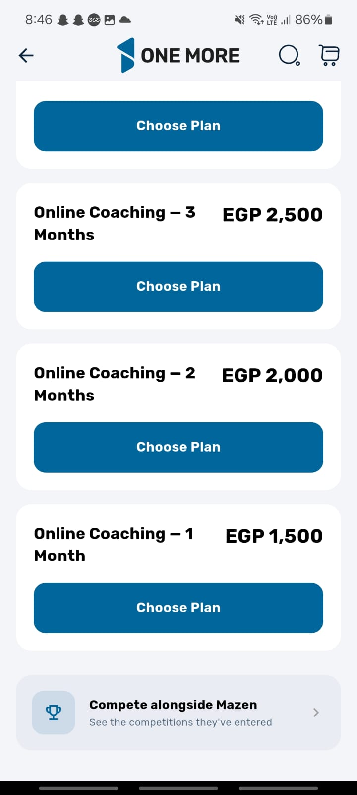
  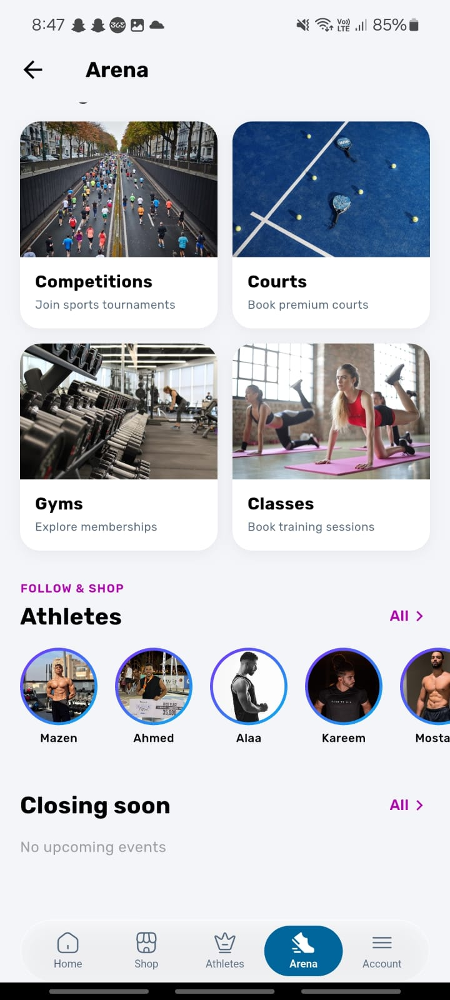
  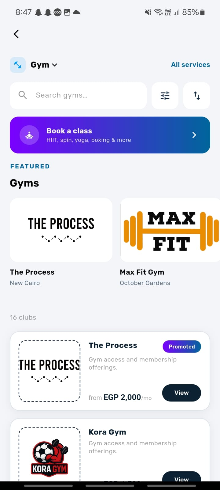
  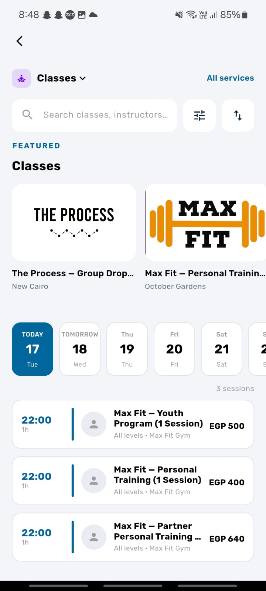
  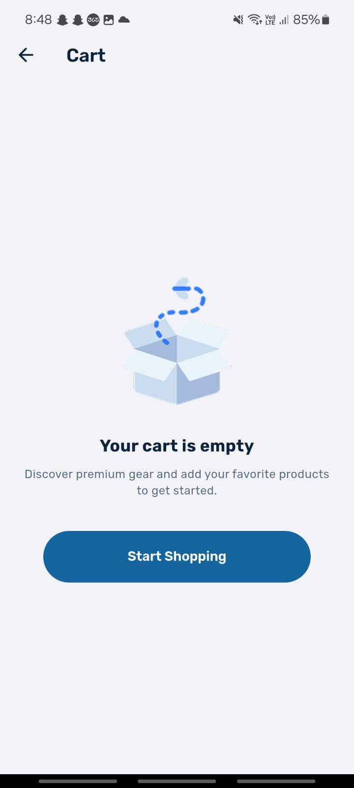
  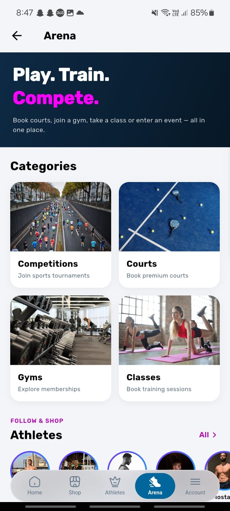
  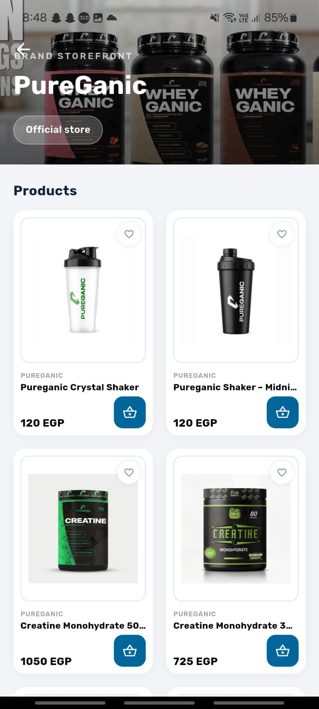
  
  
  
  
  
  
  
  
  
  
  
  
  
  

  <em>(Featuring a comprehensive UI gallery with over 30+ screens inside the assets folder)</em>

## 🛠️ Tech Stack & Architecture
- **Framework:** Flutter (Dart) & Riverpod (State Management)
- **Architecture:** Clean Architecture / Feature-first
- **APIs & Backend:** RESTful APIs, Dio, Firebase Integration
- **Platform Links:** Available on [Web](https://www.onemoreeg.com/), [Google Play](https://play.google.com/store/apps/details?id=com.irtiqadx.onemore.internal&hl=en), and [App Store](https://apps.apple.com/qa/app/one-more-sports/id6767796662).

## ✨ Key Features
- Clean, responsive, and modern UI/UX tailored for sports enthusiasts.
- Robust state management ensuring zero-lag performance.
- Secure API integration with error handling.
- Optimized and deployed for both Android & iOS production environments.
